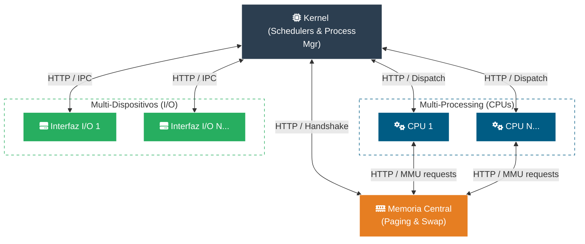

# OS Simulator – Distributed Process & Memory Management

Implementación de un entorno de simulación de Sistema Operativo distribuido, diseñado para gestionar concurrencia, planificación de CPU (Schedulers) y administración de memoria mediante comunicación HTTP entre módulos.

## 📑 Índice
- [OS Simulator – Distributed Process \& Memory Management](#os-simulator--distributed-process--memory-management)
  - [📑 Índice](#-índice)
  - [🧠 El Problema y la Motivación](#-el-problema-y-la-motivación)
  - [🏗️ Tech Stack y Arquitectura](#️-tech-stack-y-arquitectura)
  - [⚡ Features Clave](#-features-clave)
  - [📈 Aprendizajes Clave y Roadmap](#-aprendizajes-clave-y-roadmap)
  - [🖼️ Visuales y Diagramas de Impacto](#️-visuales-y-diagramas-de-impacto)
  - [⚙️ Instalación y Ejecución Local](#️-instalación-y-ejecución-local)
    - [🛠️ Scripts de Automatización y Debugging](#️-scripts-de-automatización-y-debugging)

## 🧠 El Problema y la Motivación

Construir un simulador de las entrañas de un sistema operativo real implica enfrentarse a *race conditions*, bloqueos e inanición de procesos. El desafío principal de este proyecto radicaba en lograr que cuatro módulos totalmente independientes interactúen de forma sincronizada simulando ciclos de instrucción, paginación de memoria y ruteo de I/O, sin colisionar en recursos compartidos.

Este sistema fue diseñado deliberadamente separando la lógica en microprocesos, obligando a resolver la serialización de datos (JSON) sobre HTTP y a mantener un grado de multiprogramación alto sin perder el determinismo de la simulación.

## 🏗️ Tech Stack y Arquitectura

*   **Golang:** Lenguaje base elegido por su modelo nativo de concurrencia. Goroutines y Channels resultan ideales para construir un Kernel asíncrono y planificadores.
*   **Comunicación HTTP:** Cada módulo expone un servidor HTTP (`net/http`) y los cuatro módulos principales se comunican con peticiones GET y POST con cuerpo JSON.
*   **Arquitectura Desacoplada:** El ecosistema está segmentado en `Kernel` (orquestación), `CPU` (ejecución), `Memoria` (almacenamiento y paginación) e `I/O` (periféricos).

## ⚡ Features Clave

*   **Planificadores de CPU Avanzados (Schedulers):** El Kernel implementa dinámicamente algoritmos como FIFO, Shortest Job First (SJF) y Shortest Remaining Time (SRT) con evaluación de desalojo en tiempo real (preemption).
*   **Concurrencia Segura por Diseño:** Toda la manipulación de estados de los procesos (NEW, READY, EXEC, BLOCKED) y estructuras compartidas está protegida rigurosamente utilizando primitivas de sincronización (`sync.Mutex`), para evitar condiciones de carrera.
*   **Memory Paging y Swapping:** Simulación del acceso a memoria de bajo nivel resolviendo direcciones lógicas a físicas con paginación jerárquica y un archivo de SWAP por proceso, y una caché de páginas en la CPU con reemplazo CLOCK o CLOCK-M y un TLB con reemplazo FIFO o LRU, configurables.
*   **Serialización de Paquetes:** Empaquetado de estructuras y PCB's (Process Control Blocks) como JSON, que viajan por HTTP entre la CPU y el Kernel.

## 📈 Aprendizajes Clave y Roadmap

*   **Gestión de Deadlocks y Mutexes:** Orquestar el desalojo de un proceso mediante una estimación (SRT) me enseñó los riesgos arquitectónicos de anidar *locks*. Resolví *deadlocks* latentes modificando el diseño a colas de channels asíncronos y reduciendo la granularidad de los semáforos.

## 🖼️ Visuales y Diagramas de Impacto

<div align="center">
  <h4>Arquitectura Lógica de Comunicación</h4>
</div>



## ⚙️ Instalación y Ejecución Local

Dado que el proyecto utiliza Go Workspaces y módulos distribuidos, se requiere ejecutar cada módulo en terminales separadas.

```bash
# 1. Clonar el repositorio
git clone https://github.com/tsorren/OS-Simulation-TP-SSOO.git
cd OS-Simulation-TP-SSOO

# 2. Utilizar los scripts automáticos
```

### 🛠️ Scripts de Automatización y Debugging
El repositorio cuenta con una carpeta `scripts/` que provee utilidades Bash para automatizar el ciclo de vida del entorno y facilitar el diagnóstico de fallos durante la simulación:

* **Ejecución y Despliegue:** `exec.sh`, `d_exec.sh` y `m_exec.sh` facilitan el despliegue concurrente de los módulos, evitando la necesidad de levantar terminales manualmente en entornos de desarrollo.
* **Manejo de Estados:** `limpiar_logs.sh` y `borrar_estructuras.sh` son fundamentales para devolver el entorno a un estado idempotente antes de correr un nuevo lote de procesos.
* **Debugging de Memoria:** Herramientas de bajo nivel como `hexdump_estructuras.sh`, `dump_strings.sh` y `swapfile_strings.sh` permiten realizar volcados (dumps) crudos de las estructuras de memoria y archivos de swap, críticos para auditar la correcta paginación y reemplazo de datos a nivel binario.
